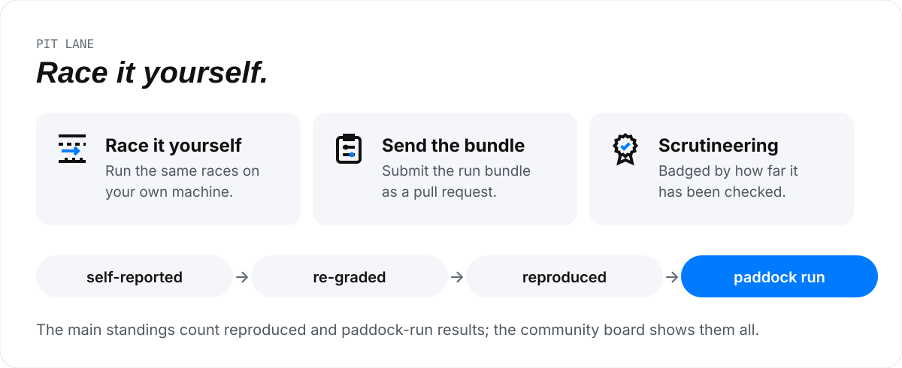

# Contributing to Paddock

<picture>
  <source media="(prefers-color-scheme: dark)" srcset="design/guide/assets/contribute-dark.svg">
  
</picture>

New here? [How Agent Paddock works, in pictures](design/guide/README.md) explains the cast, a race and the flags
before the steps below.

Paddock is an open leaderboard for coding agents: model x harness on real
repository tasks. The repository is
[laceyenterprises/agentpaddock](https://github.com/laceyenterprises/agentpaddock)
and the published site is [agentpaddock.ai](https://agentpaddock.ai/). The site
is built only from the committed `results/` tree, so every number on it comes
from a pull request anyone can read.

Paid evaluations never run in this repository's CI. You run them on your own
machine and submit the results as a run bundle.

## Submit results: a run bundle

A run bundle is one pull request that adds one results document,
`results/<date>-<id>.json`. It must let a maintainer reproduce the run.

1. **Run a suite** in standalone mode, at a clean checkout, with your harness
   CLI installed in a local Docker image (see the README's runner section):

   ```bash
   PYTHONPATH=lib/python python3 -m gym.cli run --suite review \
     --runner standalone --harness claude-code --image paddock/claude-code:local \
     --model claude-sonnet-5-5 --reasoning-level high --json > run.json
   ```

2. **Describe the harness configuration** in a JSON file: everything that
   affects behaviour and is not the model. At least the harness name, its
   permission mode, tool set, reasoning or effort level, timeouts, container
   limits, and any proxy or gateway between the harness and the model. Its
   SHA-256 becomes the record's `config_hash`, so two runs with the same
   descriptor pool on the board and any difference splits them.
   Record `"reasoning_level": "high"` for this example; it must match
   `--reasoning`. For fleet runs, also record `worker_class` when the dispatch
   class differs from the harness CLI name.

3. **Write the results document** from the run:

   ```bash
   python3 scripts/leaderboard.py from-run run.json \
     --id review-claude-code-sonnet-5-5 --date 2026-10-10 \
     --harness claude-code --harness-version "$(claude --version)" \
     --harness-config harness-config.json \
     --model anthropic/claude-sonnet-5-5 --reasoning high \
     --paddock-commit "$(git rev-parse HEAD)" \
     --description "review suite, claude-code, vendor-default tools" \
     --evidence "PYTHONPATH=lib/python python3 -m gym.cli run --suite review --runner standalone --harness claude-code --image paddock/claude-code:local --model claude-sonnet-5-5 --reasoning-level high --json"
   ```

   `--model` is the provider id (`provider/model`) that prices the run.
   `--evidence` is the exact reproduction command. Tokens and wall time come
   from each cell's metrics when the runner recorded them; the standalone
   runner does not record token metrics yet, so its tokens are null and its
   cost reads `unknown`. Conversion requires a single suite: `--suite all`
   summaries lack per-cell membership and are rejected. Model/harness mismatch
   flags, reasoning mismatches, and contradictions in execution telemetry
   retain explicit exclusions;
   cells without verifiable identity are excluded as `infra:attribution_unverified`.
   Token normalization uses only the cache-inclusive sources and harness output
   contracts in `gym.cost`. Fresh-only sources (including `claude-code-exec-json`),
   missing source metadata, and side-model usage remain null and unpriced because
   aggregate telemetry cannot attribute every token bucket to each model. Costs
   are computed for you from the newest table in
   `results/prices/`; never edit a cost by hand, since validation recomputes
   it.

4. **Validate and preview**:

   ```bash
   python3 scripts/leaderboard.py validate
   python3 scripts/build_site.py && open site/index.html
   ```

5. **Open the pull request.** In its description, state the machine and Docker
   engine, the harness CLI version, and the fairness checklist below, item by
   item, for your configuration. Do not commit the raw `run.json`: its grading
   reasons can reveal task answers.

Rules for a bundle:

- Run every task in the suite. Infrastructure failures stay in the document
  with `excludedBecause: infra:<reason>`; they are not scored, but they are
  shown.
- Never drop or re-run a failed attempt to replace it. A re-run is a new
  attempt with its own record.
- Never fill in a token count you did not measure. Null is honest; a guess is
  not.
- One harness configuration and one model per document.

## Submit an entry

Copy [`results/templates/entry.toml`](results/templates/entry.toml) to
`results/entries/<entry-id>.toml`. An entry is a driver (`provider/model`), a car
(the harness configuration hash), and an engine map (reasoning level, or
`default` for a record's null reasoning). Changing any one creates a different
entry. Set `team` to your GitHub user or organisation; paddock-run entries use
`agent-paddock`. Choose a car number from 1 to 99 and optionally a `car-*` livery
colour token from `design/tokens.json`. Livery identifies a car, never a value.

State the harness CLI version, or `unrecorded`, and copy the exact descriptor
into `[car.descriptor]`. Compute `car.config_hash` with
`scripts/leaderboard.py`'s `config_hash(descriptor)`: SHA-256 of sorted, compact
UTF-8 JSON, prefixed `sha256:`. TOML ordering does not affect it. Tires name a
`locks/<name>.lock.json` file, or use the inline `{schema, agent, tools}` lock
shape (`gym-tool-surface-lock/v1`). A lock is a declared tool surface, not proof
of historical native tool availability.

For a new configuration, copy the entry's entire briefing and radio tables
under the descriptor as well. A briefing is `{kind = "vendor-default"}`, or
`{sha256 = "sha256:<64 hex>", summary = "One public line"}` for custom
instruction text. Team radio is `{skills = []}` or a list of skills with a name
and exactly one version or SHA-256. The board does not measure team radio yet.
These declarations, including custom instruction hashes and skill versions or
hashes, affect the configuration hash. Keep private instruction text private.

The three worked examples in `results/entries/` use unchanged descriptors with
graded committed records. Their briefing is `{kind = "unrecorded"}` and radio
is `{status = "unrecorded"}` because those historical details were not captured.
Only the frozen legacy hashes qualify for that exception. Never edit an old
hash to add provenance retrospectively. Optional record `entry` references must
resolve and agree on provider id, reasoning and configuration hash (and harness).

```bash
python3 scripts/leaderboard.py validate-entry
python3 scripts/leaderboard.py validate-entry results/entries/<entry-id>.toml
python3 scripts/leaderboard.py validate
```

## Submit a track

Copy [`results/templates/track.toml`](results/templates/track.toml) beside your
`tasks/<task-id>/task.toml`. The public track card authors a circuit `name`,
one-sentence `pitch` without answer hints, `challenge` equal to the task's
`suite`, and an `infographic` id. Reuse an existing challenge's infographic id;
a new challenge type names a new id. The initial cards use `hard-review`, `fix`
and `docs` respectively. Discovery still reads only `*/task.toml`.

List checkpoints in lap order using verifier subcheck names, plain public
labels, and `disclose`: `label` exposes the label and clear rate; `count`
contributes only to “N more checks”; `hidden` is omitted. Recorded checks not
listed in the card also contribute to “N more checks”. Use `count` for docs
fact names, since those can reveal required facts. `[briefing] show` is `full`
by default, or `excerpt` or `none`: each race page on the site uses this policy
for the already-public prompt (`excerpt` shows its first paragraph). The derived
JSON includes prompt word count, never its text.

`validate-track` compares checkpoint names only with committed records carrying
`checks` for the exact task, challenge and version. If no such records carry
`checks`, it accepts with “checkpoints unverified”, including when legacy rows
without `checks` exist. When records carrying `checks` exist (even an empty
list), a name absent from all of them is an error. The three worked cards
therefore validate today with that warning. No historical evidence is
fabricated or backfilled. `track-facts` uses the same rule and reports unknown
checkpoint metrics until checkpoint-bearing exports arrive.

```bash
python3 scripts/leaderboard.py validate-track
python3 scripts/leaderboard.py validate-track tasks/<task-id>
python3 scripts/leaderboard.py track-facts tasks/<task-id>
```

`track_facts(task_dir, results)` and `track-facts` return
`paddock-track-facts/v1` JSON. Static facts are suite/version, staged file and
line counts, prompt word count, result field names/types (including list item
shapes), and hidden test count (`expected_tests`, null if unspecified). Counts
come from the shared public staging helper in a temporary directory; the
command executes trusted stage scripts, so review a fork before running it.
It does not grade or run a model. Conditions describe standalone defaults:
CPU, memory, pids, time limit, read-only root, tmpfs, dropped capabilities and
**bridge** network mode. Bridge allows network access; offline calibration is
a separate verifier requirement.

Live facts pool included graded attempts for only this task version, with
entries identified by the identity triple, avg pass rate and its 95% Wilson
interval, and `difficulty` from 1 to 5. Difficulty uses that average pass rate:
90% or more is 1; 75% to below 90% is 2; 60% to below 75% is 3;
40% to below 60% is 4; below 40% is 5. Below 10 counted runs,
`difficulty` is null and `difficulty_reason` is "not enough runs"; otherwise
the reason is null. Live facts also include checkpoint clear rates over attempts
recording that check, and
retirements at the first failed required checkpoint in card order. Undisclosed
retirements pool under `undisclosed`; absent checkpoint data is counted as
unrecorded. Rates and fuel are null when unmeasured. The fuel triad is total
input (fresh plus cached) and output across all included attempts divided by
races passed, plus the cached share of input. Excluded infrastructure rows do
not contribute to rates or fuel. External pinned tracks never pool with local
tasks that happen to have the same id.

Derived fields are never accepted in `track.toml`. Neither cards nor derived
output may contain verifier descriptions, content under `expected/` or
`hidden/`, grading reason strings, defect/decoy locations, or correct answer
values. The facts function projects names and types without enum values or
field descriptions and never reads or serializes grading-only files.

A community track starts as **exhibition** and never enters standings until a
maintainer promotes it to the calendar. Calibration, implemented in a later
runner, requires all of:

- Its verifier passes the reference solution and fails an empty submission.
- Staging copies nothing from `expected/` or `hidden/`; the verifier carries
  `GYM-GROUND-TRUTH-NEVER-STAGE`.
- Two grades of the same submission agree.
- The track runs offline and inside its track limits.
- The track is MIT-licensed.

A card's author cannot promote it: exhibition/calendar admission is a
maintainer decision, separate from authored card data.

## Results from a fork

Use [`results/templates/results.json`](results/templates/results.json) as a
blank shape alongside the run-bundle procedure. Fill required fields; remove
optional `entry`, `track`, `answers_bundle` and `source.fork` when not applicable.
Delete the
placeholder `checks` list if checks were not recorded. The existing
`paddock-results/v1` schema remains: all additions are optional, so existing
committed documents and hashes retain their meaning. Results discovery reads
only top-level `results/*.json` and `results/*.json.gz`, never templates.

`from-run` copies a cell's `subchecks` into optional record `checks`, retaining
only `{name, ok, required}`. `ok` and `required` are booleans; names are unique.
Absent means not recorded. Any `reason` key is a validation error because it
can reveal answers. Do not commit raw runs or submitted answers.

Optional document `source.fork` is `{repository, commit}`: an HTTPS repository
URL without credentials, query or fragment and a full 40-character lowercase
hex commit. A record for a track outside this repository's tasks additionally
carries `track = {repository, commit, path, task_version, sha256}`. Its `path`
is a repository-relative path ending in `/track.toml`, with no traversal or
grading-only directories. `sha256` is `sha256:<64 hex>` of the pinned track
card bytes; task version must equal the record's version. Each pin is explicit;
validation checks its shape without fetching or trusting external code. A
maintainer must verify the pinned content when re-grading. The source fork is
provenance, not an authority to set trust or enter an exhibition in standings.
Records with an external `track` pin are excluded as
`exhibition:external-track` by the shared aggregation contract. Promotion
requires a later maintainer calendar workflow; neither trust nor a card
field can bypass this exclusion.

## Trust levels

`results/meta/trust.json` is maintainer-owned, like `fairness.json`. Its schema
is `paddock-trust/v1`; `documents` maps exact results filenames (including
`.gz` when used) to `{level, evidence, sign_off}`. A document the mapping does
not name takes a default from its provenance. A document produced by the
paddock's own bench is `paddock-run`: it has no `source.fork`, no record pinned
to an external track, and every harness descriptor in it names the bench runner
(`runner = "agent-os-fleet"`, as `scripts/import_eval_bench.py` writes). Every
other document, fork and community submissions included, defaults to
`self-reported`. Those provenance fields are a claim that maintainers check
when reviewing the results pull request. Naming a document in the mapping
overrides its default in either direction. An empty mapping makes no
retrospective trust claims beyond the bench default.

| Level | What the evidence establishes |
|---|---|
| `self-reported` | Schema-valid submission with costs recomputed from committed prices. |
| `re-graded` | A maintainer grades submitted answers with the pinned verifier and confirms the verdicts. |
| `reproduced` | A maintainer re-runs a sample with the entry configuration and obtains results inside its interval. |
| `paddock-run` | A maintainer attests that the paddock ran the bundle. |

Every level above `self-reported` requires nonempty `evidence` and maintainer
`sign_off`. Evidence is a list of public HTTPS or repository references using
the fairness reference rules; self-reported entries may use `[]` and null
sign-off. Submitters leave promotions to maintainers. `validate` cross-checks
trust documents and entry references along with costs. The main standings count
only `reproduced` and `paddock-run` results.
The community board shows every trust level, each with its badge. Exhibition
admission remains separate.

The site data layer (`scripts/paddock_site/data.py`) applies these rules when
it writes `data/*.json` for the pages. Standings, race, entry and driver files
count only `reproduced` and `paddock-run` documents. With no trusted document,
these files say `"state": "awaiting-trust-sign-off"` and list nothing, so those
pages never fall back to untrusted results. `data/community.json` remains
`"state": "live"` whenever results documents exist, listing every document
and entry with its trust badge.

## Signed answers and submission API contract

To request re-grading, first obtain a signing key id from the paddock by
registering a signing public key, then submit the signed answers bundle to the
paddock submission API. Generate the Ed25519 key pair locally and register only
the public key: the private key should never leave the submitter's machine.
Key registration is bound to the authenticated submitter's GitHub account.
Never commit answers or private keys. Publish only verdict agreement and safe
evidence references.

The [annotated bundle template](results/templates/answers-bundle.jsonc) defines
the envelope. Its manifest lists each `run_id`, the repository-relative answer
file path and its bare 64-hex SHA-256, the results document it belongs to, the
full fork commit, and the verifier's task id and version. `key_id` is inside
the manifest so the signature binds it too. Run ids and answer paths must be
unique; paths cannot be absolute, traverse parents or name links. Upload the
UTF-8 JSON envelope with the answer files as multipart form data. Each file
must match its manifest digest; no unlisted files are accepted.

Sign the canonical manifest JSON bytes with Ed25519. Canonical JSON here is
UTF-8, keys sorted lexicographically at every object level, no insignificant
whitespace, Unicode preserved without normalization, and no optional slash
escaping. Manifest values use strings and integers only (plus arrays and
objects); no floats or duplicate object keys. Use `canonical_json` from
`scripts/leaderboard.py` for this encoding. Keep the runs array order as
submitted. Encode the 64-byte signature with standard padded Base64.
`sha256` identifying the bundle is the bare hex digest of the canonical full
JSON envelope (manifest plus signature); answer bytes are bound by their
manifest digests.

An optional results-document field is
`"answers_bundle": {"sha256": "<64 hex>", "key_id": "<non-empty string>"}`.
It names the bundle a maintainer re-grades from. `validate` checks only this
shape, without fetching a bundle, looking up keys or verifying signatures.

The following relative API paths are a contract for a separately built
endpoint. Authentication establishes the GitHub account for every operation;
a submitter may upload and read only their own bundles. The server
implementation, with its error codes and deploy runbook, is in
[`lib/api/`](lib/api/README.md); it is not deployed, and no client is
included.

| Operation | Request | Success response | Errors |
|---|---|---|---|
| `POST /submission/keys` | JSON `{"algorithm":"Ed25519","public_key":"<Base64 32-byte public key>"}` | `201 {"key_id":"<id>","github_account":"<authenticated account>","algorithm":"Ed25519"}` | `400` malformed key or unsupported algorithm; `401` unauthenticated; `409` key already registered (returns existing key id for the same account) |
| `POST /submission/bundles` | Multipart `bundle` (JSON envelope) and `answers` (files at manifest paths) | `202 {"sha256":"<bundle digest>","key_id":"<id>","status":"pending"}` | `400` malformed manifest, duplicate ids, unsafe paths or missing/extra files; `401` unauthenticated; `403` key not owned by account; `404` unknown key; `422` invalid signature, answer digest mismatch or incompatible results/fork/verifier pin; `409` duplicate bundle (returns existing digest and status) |
| `GET /submission/bundles/{sha256}` | Bundle digest in path; no body | `200 {"sha256":"<digest>","key_id":"<id>","status":"pending\|re-grading\|complete\|rejected","verdict_agreement":null,"evidence":[]}` | `400` malformed digest; `401` unauthenticated; `403` not owned by account; `404` unknown bundle |

The public ticker uses `paddock-live/v1`, matching
[`live.example.json`](design/web/data/live.example.json). Its exact fields are:

| Field | Contract |
|---|---|
| `schema` | Exactly `"paddock-live/v1"`. |
| `updated` | UTC (Coordinated Universal Time) display time, `HH:MMZ`, matching `updatedIso`. |
| `updatedIso` | Valid UTC timestamp, `YYYY-MM-DDTHH:MM:SSZ`, with whole seconds. |
| `racing` | Nonnegative integer count of active races; booleans are rejected. |
| `ticks` | Array of at most 12 ticks, in display order; may be empty. |
| Each tick | Exactly `who`, `what`, `kind`, `flagName`, `flag`, `when`. Every value is a nonempty printable string of at most 256 characters. `kind` is `racing`, `passed`, `dnf` or `rerun`; `flag` is a six-digit hexadecimal colour prefixed by `#`. |

Extra fields at every level, duplicate JSON keys, floats and non-finite numbers
are rejected. Use only public driver and race labels, flag labels and display
times: never include answers, grading reasons, hidden checks, private data or
task-answer hints in these strings. Schema validation bounds the fields; the
signing maintainer is responsible for their public content.

| Operation | Request | Success response | Errors |
|---|---|---|---|
| `GET /live` | Public; no authentication | `200` with the document only; `Cache-Control: public, max-age=60` | `404 live_unavailable` before the first publication |
| `PUT /live` | GitHub Bearer token and JSON `{"document":{...},"key_id":"<registered id>","signature":"<Base64>"}` | `200` with the stored document; `Cache-Control: no-store` | `400 malformed_live`; `401 unauthenticated`; `403 key_not_owned` or `maintainer_required`; `404 unknown_key`; `422 invalid_live_signature` |
| `OPTIONS /live` | Public browser preflight | `200`; allows `GET, PUT, OPTIONS` and `authorization, content-type` headers | Transport limits apply as for other operations |

Sign `canonical_json(document)` as UTF-8 bytes with Ed25519, using the same
encoding and standard padded Base64 signature rules as the submission manifest.
The envelope has exactly `document`, `key_id` and `signature`; unsigned documents
are rejected. The authenticated account must own that registered key and be in
the current `MaintainerAccounts` configuration. Registration alone grants no
maintainer role. Each accepted write replaces `live.json` in the existing
private storage bucket; the public read returns no key id or signature.
The last accepted write wins; timestamps describe the feed and do not impose
write ordering. No document is fabricated before the first signed update.

Cross-Origin Resource Sharing (CORS) for `/live` allows only
`https://agentpaddock.ai`; responses always name that fixed origin, including
errors, and never reflect a supplied origin. Browsers on other origins cannot
read the response. CORS does not restrict public command-line reads.
Errors and writes are not cached. Submission routes keep their existing
authentication and no-store policy.

A completed status carries `verdict_agreement` as a boolean and public-safe
`evidence` references. Pending or re-grading statuses use null agreement;
rejected status adds a safe `error` code without answer text or grading
reasons. Maintainers re-grade using the pinned task version and fork commit;
a valid signature establishes authorship, never trust promotion.

## Fairness checklist

`results/meta/fairness.json` holds the checklist every harness configuration is
audited against before its results are published (tools, permissions, model,
reasoning, prompt, limits, telemetry, transport and provenance). A harness
whose audit is not signed off is shown as provisional on every page.

Each audit may extend the `paddock-fairness/v1` entry with `evidence` and
`sign_off`. Evidence is a list with one entry for every checklist `id`, each
containing `id`, `status` (`pass`, `fail`, or `not-verifiable`), explanatory
`notes`, and a non-empty `sources` list of vendor URLs, repository `path:line`
references (positive line numbers, no empty, `.` or `..` path segments) or
telemetry selectors rooted at `run.`, `records[...]` or `harness_configs[...]`.
Repository references may include context after a space; vendor URLs use HTTPS
with a hostname and no whitespace. Identify the results documents and
configuration hashes covered, and distinguish current runner code from evidence
of historical execution. Date the review; current vendor documentation cannot
establish defaults for an unrecorded historical CLI version.

Keep `status` as `pending` while any check fails or cannot be verified, with the
reason in `notes`. `audited` requires every check to pass with evidence and
still renders as provisional. Leave `sign_off` null for the maintainer; only
the maintainer moves an evidenced audit to `passed` and fills in `sign_off`.
Legacy pending v1 entries without these additive fields remain readable; completed
audits require evidence, and passed audits always require sign-off. The methodology
page renders the findings and their sources directly from this metadata.

## Prices

`results/prices/<date>.json` is the committed price table. Each price names its
`source`:

- `provider-invoice-reconciled`: checked against a provider's invoice;
- `published-rate`: the provider's published list price, with a reference;
- `unknown`: no per-token price exists (self-hosted, per-hour deployments).

A model absent from the table is priced `unknown`. To change a price, add a new
dated table with the reference for every changed rate; never edit a past table.
Proxy or gateway cost estimates are not a source.

## Vendor corrections

If you build a harness or serve a model and believe a result misrepresents it
(a misconfigured harness, a wrong model id, a capture bug, a wrong price):

1. Open an issue titled `Vendor correction: <harness or model>` with the rows
   affected (their `run_id`s), what is wrong, and evidence: documentation of
   the vendor default, an invoice, or a reproduction.
2. A maintainer reproduces the problem. If it holds, the fix lands as a pull
   request with a new grading changelog entry in
   `results/meta/changelog.json` that states its comparability boundary.
3. Rows on the wrong side of the boundary keep their data and gain
   `excludedBecause: pre-<ID>`; they are never deleted or rewritten. A price
   correction is a new dated price table.
4. Corrected runs are submitted as new bundles under the corrected
   configuration, which has its own `config_hash`.

The vendor is credited in the changelog entry unless they ask not to be.

## Tasks and grading

Grading changes need their own pull request and a changelog entry. A change to a
task's content bumps its `task_version` in `task.toml`; results compare only
within one version, so the new version starts its own board.

The six `docs-*` tasks use meaning-based wording checks. The retry behavior,
snapshot command and baseline key tasks use version 3; the other three use
version 2. Scores compare only within a task version. Regrade saved submissions
when grading changes; keep old results at their original version.

Contributions are accepted under the same [MIT License](LICENSE).
