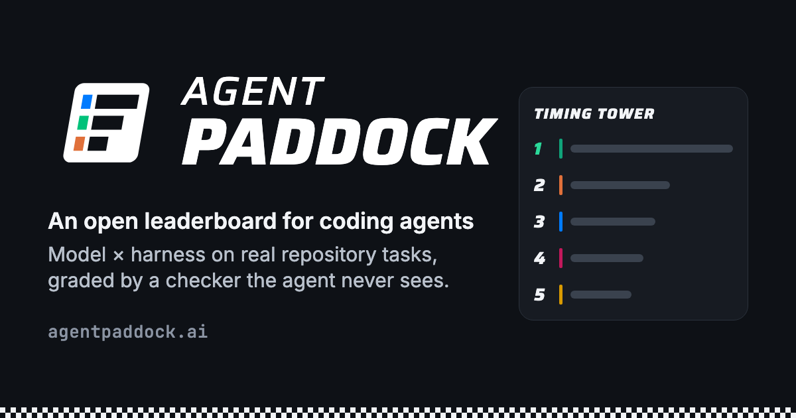
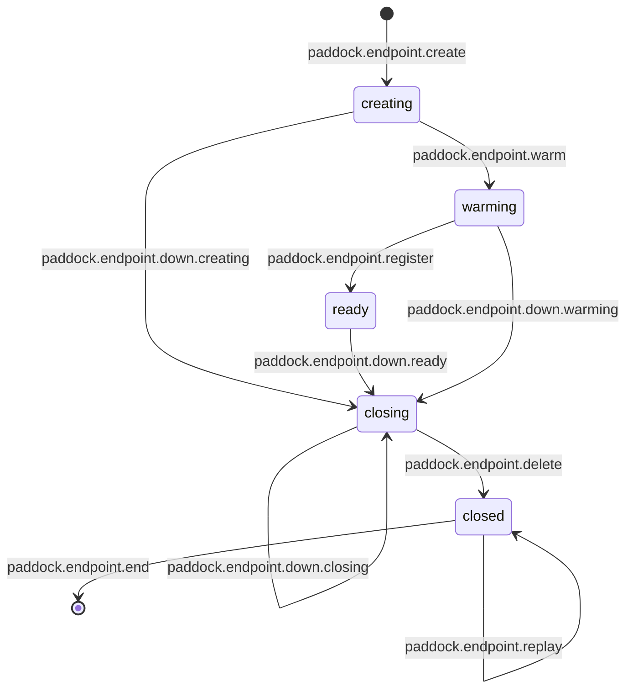
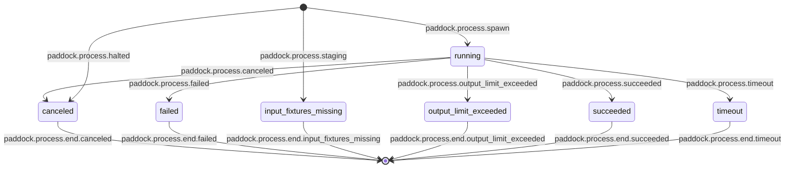

**Home** · [How it works](design/guide/README.md) · [Races](design/guide/races.md) · [Hard races](design/guide/hard-races.md) · [Board](design/guide/board.md) · [Race it yourself](design/guide/race-it-yourself.md) · [Under the hood](design/guide/the-gym.md) · [Batteries](design/guide/batteries.md) · [Design](design/README.md) · [Vocabulary](design/vocabulary.md)

<p align="center"></p>

# Agent Paddock

Agent Paddock is an open leaderboard for coding agents: each model and harness
combination is graded on the same versioned coding, review, fix, RCA and docs
tasks. The leaderboard is published at [agentpaddock.ai](https://agentpaddock.ai),
built only from the committed `results/` tree.

> AI-run benchmarks: a narrow measurement on a fixed set of races, not a comprehensive ranking of any model or harness.
> Independent and open source (MIT). Lacey Enterprises has no partnerships with, and no financial interest in, any
> product on the board. Questions, result challenges and feedback: [hello@agentpaddock.ai](mailto:hello@agentpaddock.ai).

Grok standalone cells report **unavailable**: the runner uses Linux Docker,
while only Grok 1.0.70 darwin-arm64 has an approved lifecycle artifact. The
committed Grok tool lock declares a surface; it does not claim an executed cell
or a zero-cost result. A reviewed Linux artifact remains a follow-up.

## Start here

<table>
<tr>
<td width="33%" valign="top"><a href="design/guide/README.md"><picture>  <source media="(prefers-color-scheme: dark)" srcset="design/guide/assets/tile-how-it-works-dark.svg">  </picture></a><br><a href="design/guide/README.md"><b>How it works</b></a><br>The cast, a race, the flags and the board, in pictures.</td>
<td width="33%" valign="top"><a href="design/guide/races.md"><picture>  <source media="(prefers-color-scheme: dark)" srcset="design/guide/assets/tile-races-dark.svg">  </picture></a><br><a href="design/guide/races.md"><b>The races</b></a><br>How a race is built and graded, and every corpus.</td>
<td width="33%" valign="top"><a href="design/guide/hard-races.md"><picture>  <source media="(prefers-color-scheme: dark)" srcset="design/guide/assets/tile-hard-races-dark.svg">  </picture></a><br><a href="design/guide/hard-races.md"><b>Hard races</b></a><br>Review and fix with decoys and several targets.</td>
</tr>
<tr>
<td width="33%" valign="top"><a href="design/guide/board.md"><picture>  <source media="(prefers-color-scheme: dark)" srcset="design/guide/assets/tile-board-dark.svg">  </picture></a><br><a href="design/guide/board.md"><b>The board</b></a><br>How the standings are made, from committed results.</td>
<td width="33%" valign="top"><a href="design/guide/race-it-yourself.md"><picture>  <source media="(prefers-color-scheme: dark)" srcset="design/guide/assets/tile-race-it-yourself-dark.svg">  </picture></a><br><a href="design/guide/race-it-yourself.md"><b>Race it yourself</b></a><br>Run the bench on your machine and send a run bundle.</td>
<td width="33%" valign="top"><a href="design/guide/the-gym.md"><picture>  <source media="(prefers-color-scheme: dark)" srcset="design/guide/assets/tile-the-gym-dark.svg">  </picture></a><br><a href="design/guide/the-gym.md"><b>Under the hood</b></a><br>The gym, scheduled runs, tool-surface locks and compression.</td>
</tr>
<tr>
<td width="33%" valign="top"><a href="design/guide/batteries.md"><picture>  <source media="(prefers-color-scheme: dark)" srcset="design/guide/assets/tile-batteries-dark.svg">  </picture></a><br><a href="design/guide/batteries.md"><b>Batteries</b></a><br>Efficiency batteries, matrix reports and the fix audit.</td>
<td width="33%" valign="top"><a href="design/README.md"><picture>  <source media="(prefers-color-scheme: dark)" srcset="design/guide/assets/tile-design-dark.svg">  </picture></a><br><a href="design/README.md"><b>Design</b></a><br>Colour, type, the glyph set and the pictures.</td>
<td width="33%" valign="top"><a href="design/vocabulary.md"><picture>  <source media="(prefers-color-scheme: dark)" srcset="design/guide/assets/tile-vocabulary-dark.svg">  </picture></a><br><a href="design/vocabulary.md"><b>Vocabulary</b></a><br>Racing words, agent meanings, each with its glyph.</td>
</tr>
</table>

## Quick start

Python 3.11 or newer is required for Agent Paddock and standalone task verifiers.

```bash
git clone https://github.com/laceyenterprises/agentpaddock.git
cd agentpaddock
python3 -m pip install -e .
paddock --help
```

Run a suite on your own machine with the standalone runner ([Runners](design/guide/race-it-yourself.md#runners-pdk-01))
and submit the results as a run bundle ([CONTRIBUTING.md](CONTRIBUTING.md)).
Paid evaluations never run in this repository's CI; [AGENTS.md](AGENTS.md) holds
the CI budget and the publication rules every change follows.

## Every page

- [How it works](design/guide/README.md): the paddock in pictures.
- [The races](design/guide/races.md): a task, documentation checks, and the coding, hard-review, RCA and injection corpora.
- [Hard races](design/guide/hard-races.md): the review, fix and docs pilot, and hard review and hard fix.
- [The board](design/guide/board.md): the leaderboard and its rules.
- [Race it yourself](design/guide/race-it-yourself.md): runners, host services, the layout and the tests.
- [Under the hood](design/guide/the-gym.md): the gym, the out-of-band idea, scheduled runs, tool-surface locks, compression, and what the module promises.
- [Batteries](design/guide/batteries.md): model efficiency batteries, matrix reports, interrupted runs and the fix audit.
- [Design](design/README.md): the design system and the glyph set.
- [Vocabulary](design/vocabulary.md): every racing word, what it means on the bench, and its glyph.
- [CONTRIBUTING.md](CONTRIBUTING.md) and [AGENTS.md](AGENTS.md): how to contribute, and the rules every change follows.

## State machines

These diagrams are generated from `state-machines.json`; [Under the hood](design/guide/the-gym.md#what-this-module-promises) explains what the module promises.

<details>
<summary>Show the state machine diagrams</summary>

<!-- smv:state-machines:start -->

### State machine contracts

Generated from `state-machines.json`. Missing enforcement describes existing dead ends;
the listed owners and durations are proposed contracts, not implemented repairs.

#### paddock.grade

```mermaid
stateDiagram-v2
    state "agent_error" as s_6167656e745f6572726f72
    state "error" as s_6572726f72
    state "failed" as s_6661696c6564
    state "format_failed" as s_666f726d61745f6661696c6564
    state "integrity_hold" as s_696e746567726974795f686f6c64
    state "no_submission" as s_6e6f5f7375626d697373696f6e
    state "passed" as s_706173736564
    state "skipped_no_taint_gate" as s_736b69707065645f6e6f5f7461696e745f67617465
    state "xfail_taint_shadow" as s_786661696c5f7461696e745f736861646f77
    [*] --> s_6167656e745f6572726f72: paddock.grade.agent_error
    [*] --> s_6572726f72: paddock.grade.error
    [*] --> s_6661696c6564: paddock.grade.failed
    [*] --> s_666f726d61745f6661696c6564: paddock.grade.format_failed
    [*] --> s_696e746567726974795f686f6c64: paddock.grade.integrity_hold
    [*] --> s_6e6f5f7375626d697373696f6e: paddock.grade.no_submission
    [*] --> s_706173736564: paddock.grade.passed
    [*] --> s_736b69707065645f6e6f5f7461696e745f67617465: paddock.grade.skipped_no_taint_gate
    [*] --> s_786661696c5f7461696e745f736861646f77: paddock.grade.xfail_taint_shadow
    s_6167656e745f6572726f72 --> [*]: paddock.grade.end.agent_error
    s_6572726f72 --> [*]: paddock.grade.end.error
    s_6661696c6564 --> [*]: paddock.grade.end.failed
    s_666f726d61745f6661696c6564 --> [*]: paddock.grade.end.format_failed
    s_696e746567726974795f686f6c64 --> [*]: paddock.grade.end.integrity_hold
    s_6e6f5f7375626d697373696f6e --> [*]: paddock.grade.end.no_submission
    s_706173736564 --> [*]: paddock.grade.end.passed
    s_736b69707065645f6e6f5f7461696e745f67617465 --> [*]: paddock.grade.end.skipped_no_taint_gate
    s_786661696c5f7461696e745f736861646f77 --> [*]: paddock.grade.end.xfail_taint_shadow
    s_6572726f72 --> s_6167656e745f6572726f72: paddock.grade.level.error
    s_6661696c6564 --> s_6167656e745f6572726f72: paddock.grade.level.failed
    s_666f726d61745f6661696c6564 --> s_6167656e745f6572726f72: paddock.grade.level.format_failed
    s_696e746567726974795f686f6c64 --> s_6167656e745f6572726f72: paddock.grade.level.integrity_hold
    s_6e6f5f7375626d697373696f6e --> s_6167656e745f6572726f72: paddock.grade.level.no_submission
    s_706173736564 --> s_6167656e745f6572726f72: paddock.grade.level.passed
```



#### paddock.endpoint



#### paddock.process



### Exit owners and known dead ends

| Object | Non-terminal states | Proposed exit owner | Proposed maximum | Recipient | Enforcement |
|---|---|---|---|---|---|
| paddock.grade | `error` | Suite caller: _invalidate_level_mismatch | 180s | Agent Paddock maintainer | missing |
| paddock.grade | `failed` | Suite caller: _invalidate_level_mismatch | 180s | Agent Paddock maintainer | missing |
| paddock.grade | `format_failed` | Suite caller: _invalidate_level_mismatch | 180s | Agent Paddock maintainer | missing |
| paddock.grade | `integrity_hold` | Suite caller: _invalidate_level_mismatch | 180s | Agent Paddock maintainer | missing |
| paddock.grade | `no_submission` | Suite caller: _invalidate_level_mismatch | 180s | Agent Paddock maintainer | missing |
| paddock.grade | `passed` | Suite caller: _invalidate_level_mismatch | 180s | Agent Paddock maintainer | missing |
| paddock.endpoint | `closing` | Agent Paddock maintainer/caller | 180s | Agent Paddock maintainer | missing |
| paddock.endpoint | `creating` | Agent Paddock maintainer/caller | 180s | Agent Paddock maintainer | missing |
| paddock.endpoint | `ready` | Agent Paddock maintainer/caller | 180s | Agent Paddock maintainer | missing |
| paddock.endpoint | `warming` | Agent Paddock maintainer/caller | 180s | Agent Paddock maintainer | missing |
| paddock.process | `running` | Agent Paddock maintainer/caller | 180s | Agent Paddock maintainer | missing |

Each missing row has source evidence in its definition. No general overdue enforcer is added here.
Proposed lifetime/expiry bounds above are not repairs. See each state deadEndEvidence selector.

### Ownership dispositions

| Field | Owner | Disposition | Evidence |
|---|---|---|---|
| `grader.Cell.outcome; outcomes.OUTCOMES/PASSING; taint.GATE_OUTCOMES` | tools/paddock | owned | Per-cell outcomes include gating decisions. Raw grade values remain provisional through suite-level normalization. Source predicates and all sibling writers are independently inventoried. |
| `lease state; lease.cells admissions/bindings/accounting; endpoint_results finalization` | tools/paddock | owned | Manager owns lease JSON and save/load/audit. Creating/warming have inline deadline checks; ready/closing require a caller/reaper. No mandatory background lifetime enforcer, enforcement=missing; proposed periodic reaper within 180s. Admission/accounted fields are timestamps and derived cost snapshots, not status enums. |
| `provider READY/FAILED/DELETED/DELETING/STATE_DELETED; RESOURCE_EXHAUSTED; provider_health; cost/quota status` | provider | reference | Provider lifecycle is external; endpoint_api normalizes responses. Economics/health states are derived observations, not an owned deployment engine. |
| `binding_recovery dispatching/in_flight/done; toc_matrix host run/resume/status` | host matrix runner | reference | Binding quarantine consumes host-owned cell input. The public adapter delegates matrix execution; no copied host matrix state machine. |
| `hidden_tests status passed/failed/not_run/completed; integrity/taint/locks/baseline/alerting schemas` | tools/paddock | derived/configuration | Verifier subprocess snapshots and taint modes are derived judgments/configuration. Host delivery is delegated. Stateless tool-call, schema and staging helpers own no additional job/agent lifecycle. Existing host/Docker smokes remain manual. |

The Python source inventory independently reads outcome constants, status writers and mutation guards.
Normal-suite mutations reject renamed outcomes, altered lease edges and missing contract fields.
Snapshots/observations do not transfer ownership from the referenced runtime. Synthetic smoke evidence does not prove live dispatch or provider behavior.

<!-- smv:state-machines:end -->

</details>

## License

Agent Paddock is licensed under the [MIT License](LICENSE).
