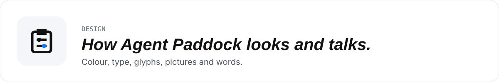
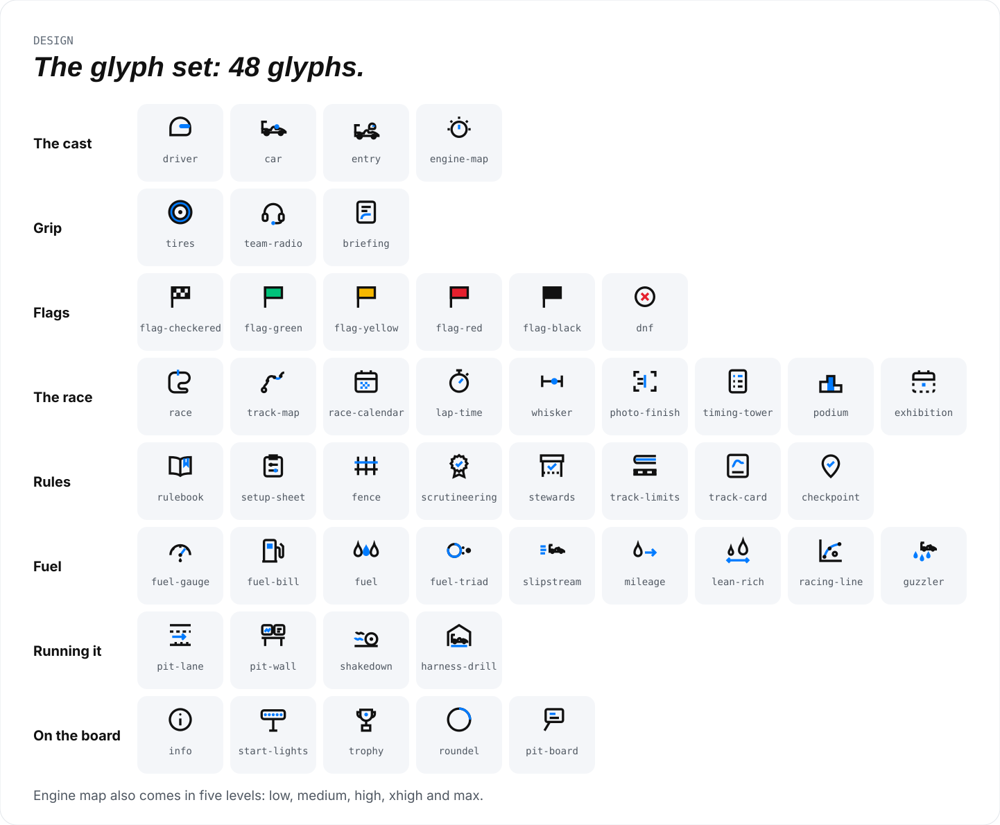

[Home](../README.md) · [How it works](guide/README.md) · [Races](guide/races.md) · [Hard races](guide/hard-races.md) · [Board](guide/board.md) · [Race it yourself](guide/race-it-yourself.md) · [Under the hood](guide/the-gym.md) · [Batteries](guide/batteries.md) · **Design** · [Vocabulary](vocabulary.md)

<picture>
  <source media="(prefers-color-scheme: dark)" srcset="guide/assets/banner-design-dark.svg">
  
</picture>

# Agent Paddock design system

How Agent Paddock looks and talks: colour, type, glyphs, illustrations, data views and words. The site, the share
card, decks and the illustration mocks all draw from it. Agent Paddock is a Lacey Enterprises project, so its brand
carries Lacey blue.

The Agent Paddock name and lockup are trademarks of Lacey Enterprises; the MIT licence covers the code and glyphs,
not the marks.

| File | What it holds |
|---|---|
| [`tokens.css`](tokens.css) | Every colour, font, space and radius token, light and dark. The source of truth. |
| [`tokens.json`](tokens.json) | The same tokens as data. Generated: `python3 design/build_tokens.py`. |
| [`vocabulary.md`](vocabulary.md) | The racing language and the wording rules. |
| [`glyphs/`](glyphs/) | The glyph sprite, its generator and a catalogue page. |
| [`canvas/`](canvas/) | The illustration and results-board mocks, as design canvas sources. |
| [`web/`](web/) | The approved design of the public site (one design file per page) and its route map. |
| [`guide/`](guide/) | The visual guide to the bench and its pictures, drawn by [`docs_art/`](docs_art/). |

In `tokens.json`, the `font`, `space` and `radius` groups omit their CSS category prefix:
`font.display`, `space["1"]` and `radius.xs` correspond to `--font-display`, `--space-1` and `--radius-xs`.
Colour keys keep their CSS names without `--`. The generator reads the plain `:root` block and the explicit
`:root[data-theme="dark"]` block, independently of block order, whitespace or attribute quote style.

## Principles

1. **One accent.** Lacey blue marks what matters on a page: a link, the highlighted series, the accent stroke of a
   glyph, the trim of a car. Everything else is ink and grey.
2. **Colour carries meaning or nothing.** Green, red, amber and black are flags. They never decorate and never stand
   for a series. A livery colour names a car (harness) and nothing else.
3. **The racing language explains, it never decorates.** Every metaphor maps to one thing the bench measures
   (see [`vocabulary.md`](vocabulary.md)). If a reader has to learn racing to read a number, drop the metaphor.
4. **Numbers are honest.** A rate says what it averages, shows its 95% interval, and comes from a committed results
   document. A tie is called a tie.
5. **Light and dark are both first class.** Every token has a dark value chosen for the dark ground, not inverted.

## Colour

Light values first, dark second. Use the token, never the hex.

| Role | Token | Light | Dark |
|---|---|---|---|
| Page | `--paper` | `#FFFFFF` | `#0C0F13` |
| Raised or soft ground | `--soft` | `#F4F6F9` | `#141920` |
| Rules and borders | `--rule` | `#E3E7EC` | `#262C35` |
| Text | `--ink` | `#111111` | `#F2F4F7` |
| Secondary text | `--ink-2` | `#4F5761` | `#B9C1CC` |
| Labels, axes, captions | `--muted` | `#626C78` | `#8B94A3` |
| **Brand accent, Lacey blue** | `--blue` | `#007BFF` | `#3D9BFF` |
| Blue text on a light ground | `--blue-ink` | `#0057B3` | `#7DBBFF` |
| Blue wash | `--blue-soft` | `#EAF3FF` | `#0F2238` |
| Pass, green flag | `--go` | `#00C27A` | `#2BD99A` |
| Red flag: infrastructure fault | `--red` | `#E5202E` | `#FF4D4F` |
| Yellow flag: pending | `--amber` | `#F5B700` | `#FFC83D` |
| Black flag: integrity hold | `--black-flag` | `#111111` | `#111111` |

**Timing tower and telemetry screens** are dark in both themes: `--tower` `#0E1116`, `--tower-2`, `--tower-rule`,
`--tower-fg`, `--tower-mute`, and `--tower-lit` `#2BD99A` for the lit position. A pit-wall screen sits on `--screen`
`#05070A` with panels on `--screen-panel` and rules in `--screen-rule`.

**Livery**, one per car, for identity only (a legend chip, a timing-tower bar): Claude Code `--car-cc`, Codex
`--car-codex`, OpenCode `--car-opencode`, Pi `--car-pi`, Antigravity `--car-agy`. Livery never encodes a value.

## Type

| Use | Family | Notes |
|---|---|---|
| Display: titles, the lockup, big numbers | Saira Condensed (`--font-display`) | 700 upright for titles; the lockup is italic, 500 for AGENT over 800 for PADDOCK |
| Body and table text | Inter (`--font-body`) | 400 and 600; tabular figures for numbers in columns |
| Labels, eyebrows, axis ticks, ids, readouts | JetBrains Mono (`--font-mono`) | 11 to 13 px, upper case, letter-spacing 0.08 to 0.1 em |

Board scale (1600 × 900): eyebrow 13, body 17 to 19, card title 22 to 30, board title 52 to 60.

## Space, radius, depth

- Space steps on a 4 px base: `--space-1` (4) to `--space-9` (80). A board keeps an 80 px margin.
- Radius: `--radius-xs` 3 (flag and glyph details), `--radius-sm` 6 (cells), `--radius-md` 8 (controls),
  `--radius-lg` 12 (cards), `--radius-xl` 18 (a monitor bezel).
- Depth comes from grounds and rules, not shadows. The one exception is a pit-wall monitor, which sits on the wall.

## Glyphs

[`glyphs/paddock-glyphs.svg`](glyphs/paddock-glyphs.svg) holds 44 line glyphs, drawn in code by Lacey Enterprises:
the cast (driver, car, entry, engine map and its five settings), grip and coaching (tires, team radio, briefing),
flags, the race and its results, rules and fairness, fuel, running the bench, and four drawn new.

- **Grammar:** a 24 px grid, 2 px strokes in `currentColor`, butt caps, mitred joins, at most one accent.
- **Accent:** the accent stroke or fill reads `--pdk-accent`, which is Lacey blue. Flags read `--pdk-green`,
  `--pdk-red`, `--pdk-yellow` and `--pdk-black`.
- **Sizes:** drawn for 24 px; legible at 16, 32 and 48.
- **Use:** inline the sprite once, then `<svg width="24" height="24"><use href="#entry"/></svg>`.
- **In Markdown:** GitHub cannot inline the sprite, so `build_docs_art.py` also writes every glyph as a tile drawn
  like the site's glyph box: [`guide/assets/glyphs/<id>-light.svg`](guide/assets/glyphs/) and `-dark.svg`. Embed
  both with `<picture>` at `width="40"`, in an HTML table cell with `width="56"`: a Markdown table squeezes the image
  otherwise. [`vocabulary.md`](vocabulary.md) shows the pattern.
- **Build:** `python3 design/glyphs/paddock_glyphs.py` writes the sprite and `index.json` (id, group, meaning);
  `python3 design/glyphs/build_sheet.py` writes the catalogue page [`glyphs/glyphs.html`](glyphs/glyphs.html).

<picture>
  <source media="(prefers-color-scheme: dark)" srcset="guide/assets/glyph-sheet-dark.svg">
  
</picture>

## Illustrations

- **The car is an Indy car:** a low open-wheel body with a single rear wing, drawn in ink, with Lacey blue on the
  helmet and the trim. It is a generic car: no real series, team, sponsor or maker likeness, and no mascots.
- **The driver sits in the car.** An entry is one model in one harness, so the helmet is always inside the cockpit.
- **Grounds:** light boards on `--soft`, dark boards on the tower ground. Track surfaces are ink; kerbs are white with
  a blue dashed trim.
- **Callouts** are a mono eyebrow, a display title and one plain line. The leader line runs from the part it names
  and ends on a short rule just above its text, so it visibly lands on the label. No dots at either end.
- **One idea per board.** If a board needs a paragraph to explain its picture, split it.
- **Docs pictures:** `python3 design/docs_art/build_docs_art.py` draws the pictures in [the visual guide](guide/README.md)
  from the glyph set and the colour tokens, one light and one dark file each. Edit the generator, never the SVGs.

## Data views

- **Pass rate is an average:** the share of counted runs that passed. Label it "avg pass rate" and say what it
  averages over.
- **Show the interval.** Every rate carries its 95% Wilson interval as a whisker; when intervals overlap at the top,
  the board says it is a tie.
- **Magnitude uses one hue:** the sequential blue ramp `--viz-seq-1` to `--viz-seq-7` (bins <50, 50-69, 70-79,
  80-89, 90-94, 95-99, 100) with a legend. Use dark text on bins 1 to 4 and light text on 5 to 7 (`--viz-seq-ink-*`).
  The dark ramp brightens with the value.
- **Highlight one series at a time.** The highlighted series is Lacey blue and everything else is `--viz-other`. Never
  more than one accent hue on a chart, and never a rainbow.
- **Fuel** is a cost per race passed: the bill in dollars, the burn in tokens. Tokens are shown as the triad
  `Input (cached %) : Output` (see [`vocabulary.md`](vocabulary.md)); a total alone hides where the fuel went.
- **One axis per chart.** Log scales for fuel, labelled as log.
- **Every chart has a hover tooltip and a table view.** The tooltip gives the counts; the table gives every row.
- **Words:** "better", never "faster" (see the wording rules).

## Components

| Component | Recipe |
|---|---|
| Card | `--paper` on `--soft`, 1 px `--rule`, `--radius-lg`, 16 to 22 px padding, mono eyebrow on top |
| Dark note card | `--tower` ground, `--tower-fg` text, `--tower-mute` eyebrow; one per board at most |
| Select (dropdown) | 16 px Inter 600, 1 px `--rule`, `--radius-md`; a mono label above; ◀ ▶ step buttons where a reader cycles |
| Stat tile | Mono label, then one display or mono number; one number per tile |
| Heat cell | A sequential bin fill, the rounded value inside, the count in its tooltip |
| Whisker | Grey 95% interval bar with a blue dot for the rate, 12 px dot with a 2 px ground ring |
| Telemetry screen | `--screen` inside a bezel, a status strip on top, mono readouts, a gauge for one headline rate |
| Fuel pump readout | Mono digits in blue on `--screen`, two readouts at most: fuel per pass and mileage |
| Flag chip | The flag glyph in its signal fill plus its word; never colour alone |

## The mocks

[`canvas/`](canvas/) holds the illustration boards and the results-board mocks: the grid, the entry, the challenges,
the standings, the pit wall, driver performance and the fuel zone. They are prototypes. Their numbers are sample
values, and the site renders these views from the committed results documents.

---

← [Batteries](guide/batteries.md) · [Vocabulary](vocabulary.md) →
