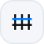

[Home](../README.md) · [How it works](guide/README.md) · [Races](guide/races.md) · [Hard races](guide/hard-races.md) · [Board](guide/board.md) · [Race it yourself](guide/race-it-yourself.md) · [Under the hood](guide/the-gym.md) · [Batteries](guide/batteries.md) · [Design](README.md) · **Vocabulary**

<picture>
  <source media="(prefers-color-scheme: dark)" srcset="guide/assets/banner-vocabulary-dark.svg">
  
</picture>

# Agent Paddock vocabulary

Agent Paddock explains a coding-agent benchmark in the language of motor racing. Each term maps to one thing the
bench measures. Use the term when it helps a reader; use the plain word when it does not.

Each glyph is the one you will see next to the word on the site and in [the pictures](guide/README.md). Every
one comes from [the glyph set](glyphs/).

**On this page:** [The cast](#the-cast) · [Racing](#racing) · [Flags](#flags-how-a-run-ended) ·
[Results](#results) · [Fuel](#fuel) · [Wording rules](#wording-rules)

## The cast

<table>
<tr><th></th><th>Racing&nbsp;term</th><th>What it means on the bench</th></tr>
<tr><td width="56" align="center"><picture><source media="(prefers-color-scheme: dark)" srcset="guide/assets/glyphs/driver-dark.svg"></picture></td><td><b>Driver</b></td><td>The model.</td></tr>
<tr><td width="56" align="center"><picture><source media="(prefers-color-scheme: dark)" srcset="guide/assets/glyphs/car-dark.svg"></picture></td><td><b>Car</b></td><td>The harness: the agent program the model runs inside (Claude Code, Codex, OpenCode, Pi, Antigravity).</td></tr>
<tr><td width="56" align="center"><picture><source media="(prefers-color-scheme: dark)" srcset="guide/assets/glyphs/entry-dark.svg"></picture></td><td><b>Entry</b></td><td>One driver in one car at one engine map. Change any one of the three and it is a different entry.</td></tr>
<tr><td width="56" align="center"><picture><source media="(prefers-color-scheme: dark)" srcset="guide/assets/glyphs/engine-map-dark.svg"></picture></td><td><b>Engine&nbsp;map</b></td><td>The effort or reasoning level: low, medium, high, xhigh, max, or the car's own default.</td></tr>
<tr><td width="56" align="center"><picture><source media="(prefers-color-scheme: dark)" srcset="guide/assets/glyphs/tires-dark.svg"></picture></td><td><b>Tires</b></td><td>The tools the car mounts: its grip on the environment.</td></tr>
<tr><td width="56" align="center"><picture><source media="(prefers-color-scheme: dark)" srcset="guide/assets/glyphs/briefing-dark.svg"></picture></td><td><b>Briefing</b></td><td>The instructions the driver gets before the lap: the system prompt and the repository's notes.</td></tr>
<tr><td width="56" align="center"><picture><source media="(prefers-color-scheme: dark)" srcset="guide/assets/glyphs/team-radio-dark.svg"></picture></td><td><b>Team&nbsp;radio</b></td><td>Skills: the coaching the crew gives the driver during the lap.</td></tr>
<tr><td width="56" align="center"><picture><source media="(prefers-color-scheme: dark)" srcset="guide/assets/livery-dark.svg"></picture></td><td><b>Livery</b></td><td>The colour that identifies a car on a board. It names the car and never encodes a value.</td></tr>
</table>

## Racing

<table>
<tr><th></th><th>Racing&nbsp;term</th><th>What it means on the bench</th></tr>
<tr><td width="56" align="center"><picture><source media="(prefers-color-scheme: dark)" srcset="guide/assets/glyphs/race-dark.svg"></picture></td><td><b>Race</b></td><td>One task.</td></tr>
<tr><td width="56" align="center"><picture><source media="(prefers-color-scheme: dark)" srcset="guide/assets/glyphs/start-lights-dark.svg"></picture></td><td><b>Run</b></td><td>One attempt at a race. A race can be run more than once.</td></tr>
<tr><td width="56" align="center"><picture><source media="(prefers-color-scheme: dark)" srcset="guide/assets/glyphs/roundel-dark.svg"></picture></td><td><b>Challenge</b></td><td>A family of races: coding, fix, hard fix, review, hard review, docs and RCA.</td></tr>
<tr><td width="56" align="center"><picture><source media="(prefers-color-scheme: dark)" srcset="guide/assets/glyphs/race-calendar-dark.svg"></picture></td><td><b>Calendar</b></td><td>The full set of races across the seven challenges.</td></tr>
<tr><td width="56" align="center"><picture><source media="(prefers-color-scheme: dark)" srcset="guide/assets/glyphs/harness-drill-dark.svg"></picture></td><td><b>Harness&nbsp;drill</b></td><td>A standard test of the car in the garage, the same for every entry.</td></tr>
<tr><td width="56" align="center"><picture><source media="(prefers-color-scheme: dark)" srcset="guide/assets/glyphs/fence-dark.svg"></picture></td><td><b>Sealed&nbsp;circuit</b></td><td>The contained environment a run happens in. The fence is the containment; race control puts the challenges on the track.</td></tr>
<tr><td width="56" align="center"><picture><source media="(prefers-color-scheme: dark)" srcset="guide/assets/glyphs/rulebook-dark.svg"></picture></td><td><b>Rulebook</b></td><td>The methodology: how races are built, run and graded.</td></tr>
<tr><td width="56" align="center"><picture><source media="(prefers-color-scheme: dark)" srcset="guide/assets/glyphs/setup-sheet-dark.svg"></picture></td><td><b>Setup&nbsp;sheet</b></td><td>A run's configuration, and the hash that pins it.</td></tr>
<tr><td width="56" align="center"><picture><source media="(prefers-color-scheme: dark)" srcset="guide/assets/glyphs/track-map-dark.svg"></picture></td><td><b>Track&nbsp;map</b></td><td>How a run works, in four sectors.</td></tr>
<tr><td width="56" align="center"><picture><source media="(prefers-color-scheme: dark)" srcset="guide/assets/glyphs/track-card-dark.svg"></picture></td><td><b>Track&nbsp;card</b></td><td>Public description and checkpoint disclosure for one race, separate from derived conditions and results.</td></tr>
<tr><td width="56" align="center"><picture><source media="(prefers-color-scheme: dark)" srcset="guide/assets/glyphs/checkpoint-dark.svg"></picture></td><td><b>Checkpoint</b></td><td>One verifier check, shown by label, count or kept hidden.</td></tr>
<tr><td width="56" align="center"><picture><source media="(prefers-color-scheme: dark)" srcset="guide/assets/glyphs/exhibition-dark.svg"></picture></td><td><b>Exhibition</b></td><td>A community race awaiting calibration and calendar admission; excluded from standings.</td></tr>
<tr><td width="56" align="center"><picture><source media="(prefers-color-scheme: dark)" srcset="guide/assets/glyphs/track-limits-dark.svg"></picture></td><td><b>Track&nbsp;limits</b></td><td>The caps a run must stay inside: CPU, memory and time.</td></tr>
<tr><td width="56" align="center"><picture><source media="(prefers-color-scheme: dark)" srcset="guide/assets/glyphs/fuel-gauge-dark.svg"></picture></td><td><b>Fuel&nbsp;gauge</b></td><td>A spend cap.</td></tr>
<tr><td width="56" align="center"><picture><source media="(prefers-color-scheme: dark)" srcset="guide/assets/glyphs/stewards-dark.svg"></picture></td><td><b>Stewards</b></td><td>The grader at the finish line. The driver never sees its checks.</td></tr>
<tr><td width="56" align="center"><picture><source media="(prefers-color-scheme: dark)" srcset="guide/assets/glyphs/scrutineering-dark.svg"></picture></td><td><b>Scrutineering</b></td><td>Inspection. A review race asks the driver to scrutineer a change: find the real defects and none that are not there.</td></tr>
<tr><td width="56" align="center"><picture><source media="(prefers-color-scheme: dark)" srcset="guide/assets/glyphs/shakedown-dark.svg"></picture></td><td><b>Shakedown</b></td><td>A smoke run that proves a car starts and finishes before it races for the board.</td></tr>
</table>

## Flags: how a run ended

<table>
<tr><th></th><th>Flag</th><th>Meaning</th><th>Counted in the pass rate?</th></tr>
<tr><td width="56" align="center"><picture><source media="(prefers-color-scheme: dark)" srcset="guide/assets/glyphs/flag-checkered-dark.svg"></picture></td><td><b>Checkered</b></td><td>Finished: the run passed its checks.</td><td><b>Yes</b></td></tr>
<tr><td width="56" align="center"><picture><source media="(prefers-color-scheme: dark)" srcset="guide/assets/glyphs/dnf-dark.svg"></picture></td><td><b>DNF</b></td><td>Did not finish: it failed its checks or handed in no answer.</td><td><b>Yes</b></td></tr>
<tr><td width="56" align="center"><picture><source media="(prefers-color-scheme: dark)" srcset="guide/assets/glyphs/flag-red-dark.svg"></picture></td><td><b>Red</b></td><td>An infrastructure fault, not the model. The run is left out and run again.</td><td>No</td></tr>
<tr><td width="56" align="center"><picture><source media="(prefers-color-scheme: dark)" srcset="guide/assets/glyphs/flag-black-dark.svg"></picture></td><td><b>Black</b></td><td>An integrity hold, set aside for a person to review.</td><td>No</td></tr>
<tr><td width="56" align="center"><picture><source media="(prefers-color-scheme: dark)" srcset="guide/assets/glyphs/flag-green-dark.svg"></picture></td><td><b>Green</b></td><td>Running: lights out.</td><td>Not a result</td></tr>
<tr><td width="56" align="center"><picture><source media="(prefers-color-scheme: dark)" srcset="guide/assets/glyphs/flag-yellow-dark.svg"></picture></td><td><b>Yellow</b></td><td>An audit is pending.</td><td>Not yet</td></tr>
</table>

A flag always travels with its word. Its colour is a signal, never the only one.

## Results

<table>
<tr><th></th><th>Racing&nbsp;term</th><th>What it means on the bench</th></tr>
<tr><td width="56" align="center"><picture><source media="(prefers-color-scheme: dark)" srcset="guide/assets/glyphs/timing-tower-dark.svg"></picture></td><td><b>Standings</b></td><td>The leaderboard: entries ranked by their average pass rate.</td></tr>
<tr><td width="56" align="center"><picture><source media="(prefers-color-scheme: dark)" srcset="guide/assets/glyphs/whisker-dark.svg"></picture></td><td><b>Whiskers</b></td><td>The 95% interval drawn around every pass rate.</td></tr>
<tr><td width="56" align="center"><picture><source media="(prefers-color-scheme: dark)" srcset="guide/assets/glyphs/photo-finish-dark.svg"></picture></td><td><b>Photo&nbsp;finish</b></td><td>A tie at the top: the leaders' 95% intervals overlap, so the board does not name a winner.</td></tr>
<tr><td width="56" align="center"><picture><source media="(prefers-color-scheme: dark)" srcset="guide/assets/glyphs/pit-wall-dark.svg"></picture></td><td><b>Pit&nbsp;wall</b></td><td>Telemetry. On the results boards: one car's results, every driver and engine map that raced in it, challenge by challenge.</td></tr>
<tr><td width="56" align="center"><picture><source media="(prefers-color-scheme: dark)" srcset="guide/assets/glyphs/timing-tower-dark.svg"></picture></td><td><b>Timing&nbsp;tower</b></td><td>The ranked list of entries, as on a race broadcast.</td></tr>
<tr><td width="56" align="center"><picture><source media="(prefers-color-scheme: dark)" srcset="guide/assets/glyphs/podium-dark.svg"></picture> <picture><source media="(prefers-color-scheme: dark)" srcset="guide/assets/glyphs/trophy-dark.svg"></picture></td><td><b>Podium,&nbsp;trophy</b></td><td>The top three; a category winner.</td></tr>
<tr><td width="56" align="center"><picture><source media="(prefers-color-scheme: dark)" srcset="guide/assets/glyphs/lap-time-dark.svg"></picture></td><td><b>Lap&nbsp;time</b></td><td>Wall-clock time for a run. The only place a time word belongs.</td></tr>
</table>

## Fuel

<table>
<tr><th></th><th>Racing&nbsp;term</th><th>What it means on the bench</th></tr>
<tr><td width="56" align="center"><picture><source media="(prefers-color-scheme: dark)" srcset="guide/assets/glyphs/fuel-bill-dark.svg"></picture></td><td><b>Fuel&nbsp;bill</b></td><td>Dollars per race passed.</td></tr>
<tr><td width="56" align="center"><picture><source media="(prefers-color-scheme: dark)" srcset="guide/assets/glyphs/fuel-dark.svg"></picture></td><td><b>Fuel&nbsp;burn</b></td><td>Tokens per race passed.</td></tr>
<tr><td width="56" align="center"><picture><source media="(prefers-color-scheme: dark)" srcset="guide/assets/glyphs/fuel-triad-dark.svg"></picture></td><td><b>The&nbsp;fuel&nbsp;triad</b></td><td><code>Input (cached %) : Output</code>, per race passed. Input is every token sent to the model, cached % is the share of it read from the prompt cache, and output is what the model wrote. Example: <code>82k (81%) : 4k</code>.</td></tr>
<tr><td width="56" align="center"><picture><source media="(prefers-color-scheme: dark)" srcset="guide/assets/glyphs/slipstream-dark.svg"></picture></td><td><b>Slipstream</b></td><td>Cached tokens: most of the fuel, at a fraction of the price of fresh input.</td></tr>
<tr><td width="56" align="center"><picture><source media="(prefers-color-scheme: dark)" srcset="guide/assets/glyphs/mileage-dark.svg"></picture></td><td><b>Mileage</b></td><td>Races passed per $10, or per million tokens.</td></tr>
<tr><td width="56" align="center"><picture><source media="(prefers-color-scheme: dark)" srcset="guide/assets/glyphs/lean-rich-dark.svg"></picture></td><td><b>Lean,&nbsp;rich</b></td><td>The two ends of the fuel axis: less fuel per pass, more fuel per pass.</td></tr>
<tr><td width="56" align="center"><picture><source media="(prefers-color-scheme: dark)" srcset="guide/assets/glyphs/racing-line-dark.svg"></picture></td><td><b>Racing&nbsp;line</b></td><td>The best-value line: the entries that nothing burning less fuel beats on pass rate.</td></tr>
<tr><td width="56" align="center"><picture><source media="(prefers-color-scheme: dark)" srcset="guide/assets/glyphs/guzzler-dark.svg"></picture></td><td><b>The&nbsp;guzzler</b></td><td>The entry that burns the most fuel per race passed.</td></tr>
</table>

## Wording rules

- **Say "better", never "faster", "quicker" or "fastest".** Speed words read as wall-clock time for the run. "Does
  more effort make this model better?", "the best entry in this car".
- **Models are in harnesses, not on them.** "GPT-6.1 Sol in Pi".
- **Name the average.** A pass rate is an average over runs: write "avg pass rate" and say what it covers.
- **Call ties ties.** When intervals overlap, the board says so instead of naming a winner.
- **Give tokens as the triad**, with a legend nearby, not as a bare total.
- **No real-world likeness.** No real racing series, team, driver, sponsor or car maker.

---

← [Design](README.md) · [Home](../README.md)
